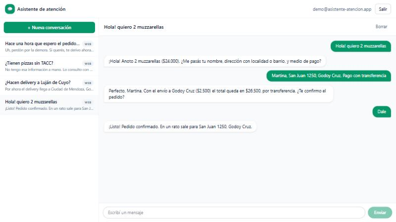

# Asistente de atención — demo

Demo de un asistente de atención al cliente con IA, armada para practicar
**Firebase (Authentication, Firestore y Cloud Functions)** sobre mi stack de
siempre: **Next.js, TypeScript y Tailwind**.

🔗 **Demo:** [asistente-atencion.vercel.app](https://asistente-atencion.vercel.app)
— entrá con **Probar con la cuenta demo** para ver conversaciones de ejemplo
sin registrarte, o escribile al asistente como si fueras un cliente.



> Es un proyecto de aprendizaje, no un sistema en producción. El negocio
> ("Pizzería Don Zonda") es ficticio.

## Qué hace

- **Login** con email y contraseña o con Google (Firebase Authentication).
- **Panel** con la lista de conversaciones y el chat, actualizado en tiempo
  real con `onSnapshot` de Firestore.
- **Respuestas con IA**: cuando el cliente escribe, el servidor arma el
  historial, consulta a Gemini y guarda la respuesta en Firestore.
- **Borrar conversaciones** con sus mensajes, desde el servidor
  (`recursiveDelete`), porque Firestore no borra subcolecciones solo.
- **Reglas de Firestore** para que cada usuario vea solo sus conversaciones y
  el cliente no pueda escribir mensajes como si fuera el asistente.

## Cómo está armado

```
Panel (Next.js) ──1. escribe mensaje "user"──► Firestore
     │                                            ▲   │
     │ 2. POST /api/reply + ID token              │   │ 4. onSnapshot
     ▼                                            │   ▼
API route (Next.js) ──3. Gemini → guarda respuesta┘  Panel
```

1. El panel guarda el mensaje del cliente en Firestore (las reglas solo le
   permiten escribir mensajes con `role: "user"`).
2. Llama a `/api/reply` con el ID token de Firebase Auth.
3. La API verifica el token con el Admin SDK, comprueba que la conversación
   sea del usuario, le pide la respuesta a Gemini y la guarda.
4. El panel la ve aparecer en tiempo real.

La API es idempotente: si el último mensaje ya tiene respuesta, no hace nada,
así que reintentar es seguro.

### ¿Y Cloud Functions?

En `functions/` está la misma lógica como Cloud Function
(`onDocumentCreated` sobre cada mensaje nuevo), que es la opción más natural
en Firebase: el cliente solo escribe en Firestore y no necesita llamar a
ninguna API. No está desplegada porque Cloud Functions requiere el plan Blaze
(con tarjeta), y la demo corre entera en planes gratuitos: Firebase Spark,
Vercel Hobby y el free tier de Gemini. Para pasarla a Cloud Functions basta
con desplegar `functions/` y sacar la llamada a `/api/reply` del panel.

```
src/
  app/page.tsx              login
  app/panel/page.tsx        panel (ruta protegida)
  app/api/reply/route.ts    genera y guarda la respuesta del asistente
  app/api/conversations/    borra una conversación con sus mensajes
  components/               LoginForm, ConversationList, ChatWindow
  lib/firebase.ts           SDK de cliente
  lib/auth-context.tsx      sesión y métodos de login
  lib/chat.ts               modelo de datos y consultas a Firestore
  lib/server/               Admin SDK y prompt del asistente (solo servidor)
functions/src/index.ts      versión con Cloud Function (requiere Blaze)
firestore.rules             reglas de seguridad
firestore.indexes.json      índice para la lista de conversaciones
```

## Puesta en marcha

1. Crear un proyecto en la [consola de Firebase](https://console.firebase.google.com/)
   y, dentro, una app web.
2. Activar **Authentication** (Email/contraseña y Google) y crear la base de
   **Firestore**.
3. Generar una clave de **service account** (Configuración del proyecto →
   Cuentas de servicio → Generar nueva clave privada) y una API key de
   Gemini en [Google AI Studio](https://aistudio.google.com/apikey).
4. Copiar `.env.example` a `.env.local` y completarlo.
5. Instalar y subir reglas e índices:

   ```bash
   npm install
   npm i -g firebase-tools
   firebase login
   firebase deploy --only firestore
   ```

   En `.firebaserc`, poner el ID de tu proyecto.

6. Levantar el panel:

   ```bash
   npm run dev
   ```

## Cuenta demo

`npm run seed:demo` crea (o reinicia) una cuenta demo con cuatro
conversaciones de ejemplo: un pedido completo, una dirección fuera de zona,
una pregunta que el asistente no sabe responder y un cliente molesto. Usa
`NEXT_PUBLIC_DEMO_EMAIL` y `NEXT_PUBLIC_DEMO_PASSWORD` del `.env.local`; si
esas variables también están en Vercel, el login muestra el botón
**Probar con la cuenta demo**.

Se puede volver a correr cuando haga falta dejar la demo limpia.

## Próximos pasos

- [ ] Webhook de WhatsApp Cloud API (número de prueba de Meta).
- [ ] Derivar la conversación a una persona del equipo.
- [ ] Guardar los pedidos confirmados en Firestore y mostrarlos en el panel.
- [x] Deploy del panel en Vercel.
